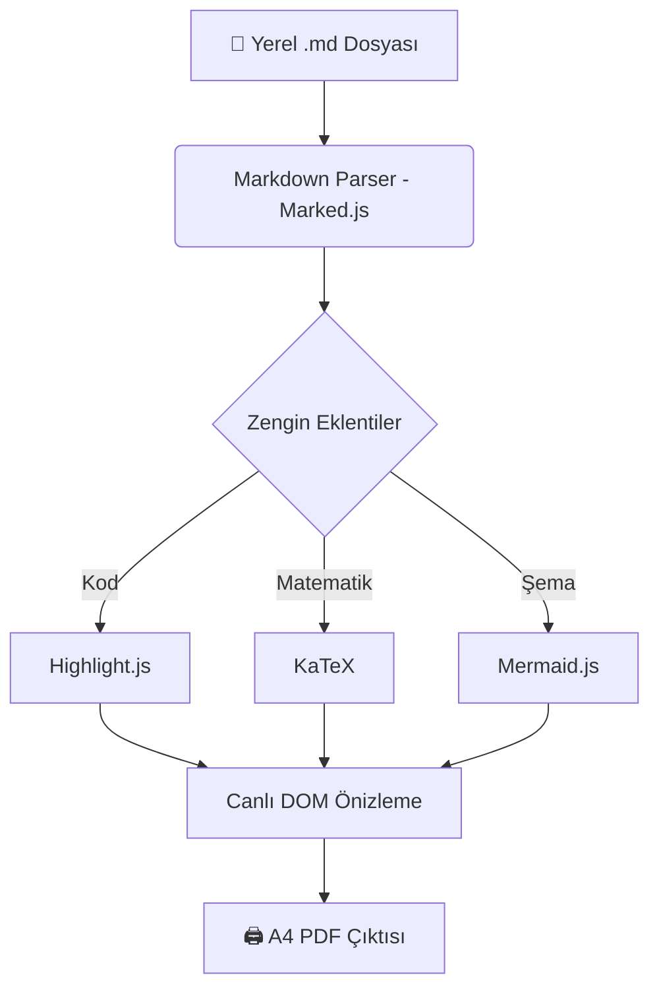
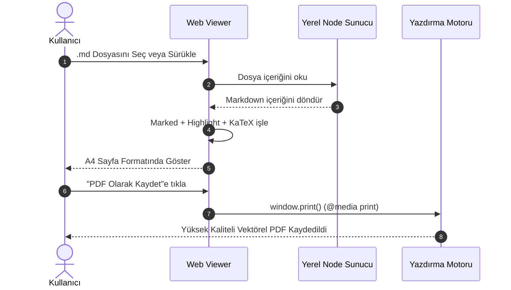

# Markdown Viewer & PDF Projesi

Modern, hızlı ve yerel çalışan **Markdown Görüntüleyici ve PDF Dönüştürücü** aracına hoş geldiniz!

Bu döküman, uygulamanın desteklediği zengin biçimlendirme özelliklerini (kod renklendirme, tablolar, matematiksel formüller, diyagramlar ve sayfa bölmeleri) test etmek amacıyla hazırlanmıştır.

---

## 🚀 Temel Özellikler

- [x] **Yerel Dosya Desteği**: Bilgisayarınızdaki `.md` dosyalarını sürükleyip bırakın veya klasör olarak açın.
- [x] **Piksel Hassasiyetinde PDF**: A4 kağıt standartlarına tam uyumlu, sayfa numaralı vektörel PDF çıktısı.
- [x] **Canlı Önizleme & Düzenleme**: İster sadece okuyun, ister çift panelde anlık olarak düzenleyin.
- [x] **Mermaid Diyagramları**: Metin tabanlı akış şemaları ve mimari diyagramları.
- [x] **KaTeX Matematik Desteği**: Karmaşık matematiksel ve fiziksel formüller.
- [x] **GitHub Callout'ları**: Bilgilendirme, uyarı ve ipucu kutuları.

---

## 💡 Bilgi ve İpucu Kutuları (Callouts)

> [!NOTE]
> Bu uygulama tamamen **yerel (local)** çalışır. Dosyalarınız hiçbir harici sunucuya veya buluta yüklenmez.

> [!TIP]
> PDF çıktısı alırken tarayıcınızın yazdırma penceresinde **"Arka plan grafikleri"** (Background graphics) seçeneğini işaretlemeyi unutmayın.

> [!WARNING]
> PDF oluştururken belirli bir noktadan yeni sayfaya geçmek isterseniz dökümana `<!-- pagebreak -->` ekleyebilirsiniz.

> [!IMPORTANT]
> A4 sayfa görünümü butonu ile dökümanınızın sayfalandırılmış halini baskı öncesinde birebir ekranda görebilirsiniz.

---

## 💻 Kod Blokları ve Sözdizimi Vurgulama

Aşağıda farklı programlama dillerine ait örnek kod blokları yer almaktadır:

### JavaScript / Node.js
```javascript
import fs from 'fs/promises';
import { marked } from 'marked';

async function convertMarkdown(filePath) {
  const markdownText = await fs.readFile(filePath, 'utf-8');
  const htmlContent = marked.parse(markdownText);
  console.log('Dönüştürme tamamlandı! Boyut:', htmlContent.length);
  return htmlContent;
}
```

### Python
```python
import os
from pathlib import Path

def scan_markdown_files(directory: str) -> list[Path]:
    """Belirtilen dizindeki tüm .md dosyalarını listeler."""
    base_dir = Path(directory)
    return sorted(list(base_dir.glob("**/*.md")))

if __name__ == "__main__":
    files = scan_markdown_files(".")
    print(f"Toplam {len(files)} markdown dosyası bulundu.")
```

### SQL
```sql
SELECT 
    d.id,
    d.title,
    d.author,
    COUNT(c.id) AS comment_count,
    d.created_at
FROM documents d
LEFT JOIN comments c ON d.id = c.document_id
WHERE d.status = 'published'
GROUP BY d.id
ORDER BY d.created_at DESC
LIMIT 10;
```

<!-- pagebreak -->

## 📊 Karşılaştırma Tablosu

Aşağıdaki tablo, Markdown'dan PDF'e dönüştürme yaklaşımlarını özetlemektedir:

| Yöntem | Hız | Kurulum Zorluğu | Sayfa Mizanpajı | Vektörel Kalite |
| :--- | :---: | :---: | :---: | :---: |
| **Tarayıcı Yazdırma (CSS @print)** | ⚡ Çok Hızlı | Sıfır Kurulum | Mükemmel (A4) | %100 Vektörel |
| **html2pdf.js (Canvas)** | Hızlı | Sıfır Kurulum | İyi | Raster / Görüntü |
| **Puppeteer (Headless Chrome)** | Orta | Node.js + Chrome | Kusursuz | %100 Vektörel |
| **WeasyPrint / Typst** | Çok Hızlı | Python / Rust CLI | Kitap Kalitesinde | %100 Vektörel |

---

## 🧮 Matematiksel Formüller (KaTeX)

Satır içi matematik formülleri: Einstein'ın kütle-enerji eşdeğerliği $E = mc^2$ veya Pisagor bağıntısı $a^2 + b^2 = c^2$.

Ayrı blok halinde gösterilen karmaşık denklemler:

$$\int_{-\infty}^{\infty} e^{-x^2} dx = \sqrt{\pi}$$

Euler Özdeşliği ve Normal Dağılım Fonksiyonu:

$$f(x) = \frac{1}{\sigma \sqrt{2\pi}} e^{-\frac{1}{2}\left(\frac{x-\mu}{\sigma}\right)^2}$$

---

## 📈 Mermaid Diyagramları

Uygulama, metin tabanlı Mermaid mimari ve akış şemalarını otomatik olarak render eder:

### Sistem Akış Şeması


### Sıralama Diyagramı (Sequence Diagram)


---

## 📝 Alıntılar ve Referanslar

> "Sadelik, mükemmelliğin en üst noktasıdır."  
> — *Leonardo da Vinci*

Markdown dosyalarınızdaki tüm alıntılar, kalın, italik, üstü çizili (`~~silinmiş~~`) ve dipnotlar standartlara uygun şekilde işlenir.
