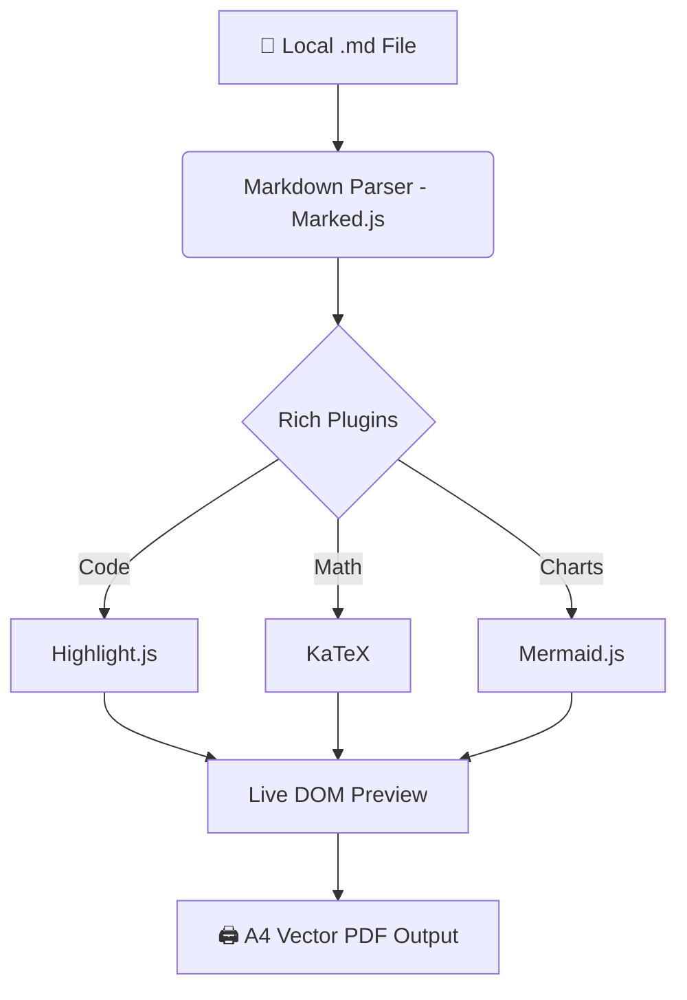
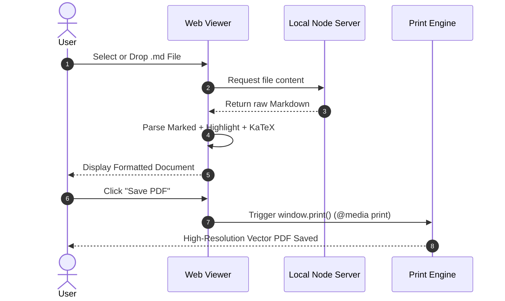

# Markdown Viewer & PDF

Welcome to **Simple Markdown Viewer & PDF Converter** — a fast, local-first tool for viewing, editing, and exporting Markdown documents with pixel-perfect A4 PDF layout.

This document demonstrates all supported formatting capabilities, including syntax highlighting, math equations, diagrams, callouts, tables, and page breaks.

---

## 🚀 Key Features

- [x] **Local File Support**: Drag & drop `.md` files or open entire folders from your computer.
- [x] **Pixel-Perfect Vector PDF**: Optimized for A4 printing with zero awkward page splits.
- [x] **Live Preview & Split View**: Read peacefully or edit side-by-side with instant live rendering.
- [x] **Mermaid Diagrams**: Flowcharts, sequence diagrams, and architecture charts.
- [x] **KaTeX Math Engine**: Inline and block equations rendered at typesetting quality.
- [x] **GitHub-Flavored Callouts**: Notes, tips, warnings, and alerts.

---

## 💡 Information & Alert Callouts

> [!NOTE]
> This application runs **100% locally**. Your files and notes are never uploaded to any external server or cloud.

> [!TIP]
> When exporting to PDF via the browser print dialog, make sure **"Background graphics"** is enabled for rich card colors.

> [!WARNING]
> To force a clean page break in your PDF output at a specific location, insert `<!-- pagebreak -->` into your document.

> [!IMPORTANT]
> Toggle the **A4 Mode** button in the top navigation bar to preview your document exactly as it will appear on printed paper.

---

## 💻 Code Blocks & Syntax Highlighting

Below are sample code blocks in various programming languages:

### JavaScript / Node.js
```javascript
import fs from 'fs/promises';
import { marked } from 'marked';

async function convertMarkdown(filePath) {
  const markdownText = await fs.readFile(filePath, 'utf-8');
  const htmlContent = marked.parse(markdownText);
  console.log('Conversion complete! HTML size:', htmlContent.length);
  return htmlContent;
}
```

### Python
```python
import os
from pathlib import Path

def scan_markdown_files(directory: str) -> list[Path]:
    """Scan and list all .md files in the given directory recursively."""
    base_dir = Path(directory)
    return sorted(list(base_dir.glob("**/*.md")))

if __name__ == "__main__":
    files = scan_markdown_files(".")
    print(f"Found {len(files)} markdown files.")
```

### SQL
```sql
SELECT 
    d.id,
    d.title,
    d.author,
    COUNT(c.id) AS comment_count,
    d.created_at
FROM documents d
LEFT JOIN comments c ON d.id = c.document_id
WHERE d.status = 'published'
GROUP BY d.id
ORDER BY d.created_at DESC
LIMIT 10;
```

<!-- pagebreak -->

## 📊 Comparison Table

The table below outlines common Markdown-to-PDF export approaches:

| Method | Speed | Setup Complexity | Page Layout | Vector Quality |
| :--- | :---: | :---: | :---: | :---: |
| **Browser Print (CSS @print)** | ⚡ Ultra Fast | Zero Setup | Pixel-Perfect (A4) | 100% Vector |
| **html2pdf.js (Canvas)** | Fast | Zero Setup | Moderate | Raster / Image |
| **Puppeteer (Headless Chrome)** | Moderate | Node.js + Chrome | Pixel-Perfect | 100% Vector |
| **WeasyPrint / Typst** | Very Fast | Python / Rust CLI | Publication Quality | 100% Vector |

---

## 🧮 Mathematical Equations (KaTeX)

Inline math formulas: Einstein's mass-energy equivalence $E = mc^2$ or the Pythagorean theorem $a^2 + b^2 = c^2$.

Display math equations:

$$\int_{-\infty}^{\infty} e^{-x^2} dx = \sqrt{\pi}$$

Euler's Identity and the Gaussian Normal Distribution:

$$f(x) = \frac{1}{\sigma \sqrt{2\pi}} e^{-\frac{1}{2}\left(\frac{x-\mu}{\sigma}\right)^2}$$

---

## 📈 Mermaid Diagrams

Text-based diagrams are rendered automatically into interactive SVG charts:

### Architecture Flowchart


### Sequence Diagram


---

## 📝 Quotes & Typography

> "Simplicity is the ultimate sophistication."  
> — *Leonardo da Vinci*

Markdown files support bold, italic, strikethrough (`~~deleted~~`), task lists, and quotes seamlessly.
